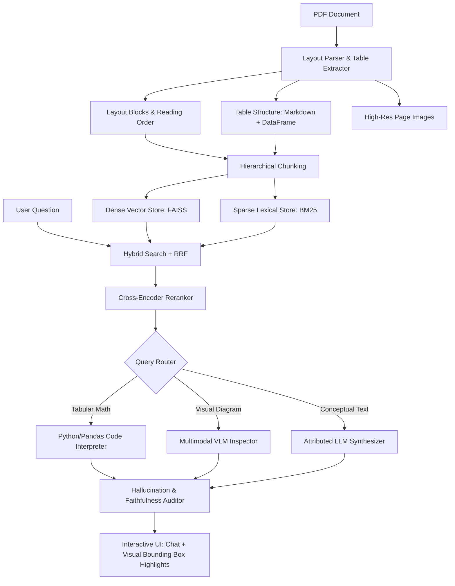

# RAG-Based Document Intelligent System

> **Architectural Reference Paper:**  
> *Large Language Models in Document Intelligence: A Comprehensive Survey, Recent Advances, Challenges, and Future Trends*  
> **Authors:** Wenjun Ke, Yifan Zheng, Yining Li, Hengyuan Xu, Dong Nie, Peng Wang, Yao He  
> **Published in:** *ACM Transactions on Information Systems (TOIS)*, Vol. 44, No. 1, 2026.  
> **DOI:** [10.1145/3768156](https://dl.acm.org/doi/full/10.1145/3768156)

---

## 🌟 Overview

This repository provides an enterprise-ready **RAG-Based Document Intelligent System** developed in direct accordance with the taxonomy and recommendations formulated in Ke et al. (ACM TOIS 2026).

Traditional RAG systems fail when applied to complex business documents because naive text extraction breaks multi-column reading order, flattens tabular matrices into noisy 1D token strings (causing severe arithmetic hallucinations), and ignores visual diagrams.

This system resolves these bottlenecks by combining:
1. **Document Layout Analysis (DLA)** and **Table Structure Recognition (TSR)** with bounding box extraction.
2. **Hierarchical, Structure-Aware Chunking** preserving document section breadcrumbs and table integrity.
3. **Hybrid Dense (FAISS) + Sparse (BM25) Retrieval** fused via **Reciprocal Rank Fusion (RRF)**.
4. **Cross-Encoder Neural Re-ranking** (`ms-marco-MiniLM-L-6-v2`) to eliminate the "Lost in the Middle" problem.
5. **Agentic Tool-Augmented Reasoning**:
   - **Deterministic Code Interpreter**: Translates tabular questions into Python/Pandas operations, guaranteeing 100% arithmetic precision.
   - **Multimodal VLM Inspector**: Inspects visual plots, stamps, and layout structures.
   - **Self-Reflection & Hallucination Auditor**: Verifies that every claim is grounded in retrieved context.
6. **Side-by-Side Visual Grounding**: Displays document pages with highlighted bounding boxes corresponding to cited evidence.

---

## 🏗️ Architecture



---

## 📁 Directory Structure

```
RAG-Based Document Intelligent System/
├── backend/
│   ├── app/
│   │   ├── core/
│   │   │   ├── config.py           # Configuration & model settings
│   │   │   └── models.py           # Pydantic schemas (Blocks, BoundingBox, Tables, Citations)
│   │   ├── parser/
│   │   │   ├── layout_parser.py    # DLA: Reading order, headers, paragraphs, bounding boxes
│   │   │   ├── table_extractor.py  # TSR: Table extraction to Markdown, CSV, and DataFrames
│   │   │   └── vision_renderer.py  # High-res rendering & citation bounding box overlays
│   │   ├── indexer/
│   │   │   ├── chunker.py          # Structure-aware hierarchical chunker
│   │   │   ├── embeddings.py       # Google GenAI gemini-embedding-001 with local fallback
│   │   │   └── hybrid_store.py     # FAISS IndexFlatIP + Rank-BM25 with disk persistence
│   │   ├── retriever/
│   │   │   ├── hybrid_retriever.py # Reciprocal Rank Fusion (RRF) search
│   │   │   └── reranker.py         # Cross-Encoder neural reranker
│   │   ├── agent/
│   │   │   ├── router.py           # Intent routing (Calculation, Visual, Text, Multi-Hop)
│   │   │   ├── code_interpreter.py # Deterministic Python/Pandas tool for tables
│   │   │   ├── visual_inspector.py # Multimodal VLM for visual diagrams
│   │   │   ├── synthesizer.py      # Attributed QA with bracketed citations
│   │   │   ├── verifier.py         # Self-reflection hallucination critic
│   │   │   └── orchestrator.py     # Master orchestrator
│   │   └── api/
│   │       ├── main.py             # FastAPI app entrypoint
│   │       └── routes.py           # REST endpoints
│   └── tests/
│       ├── create_sample_pdf.py    # Benchmark PDF generator
│       ├── test_parser.py          # DLA & TSR tests
│       ├── test_indexer.py         # Chunker & HybridStore tests
│       ├── test_retriever.py       # RRF & Reranker tests
│       ├── test_agent.py           # Router, Code Interpreter & Auditor tests
│       └── test_e2e.py             # Full End-to-End pipeline test
├── frontend/
│   └── app.py                      # Modern Streamlit UI with visual PDF viewer
├── data/
│   └── sample_docs/                # Benchmark documents
├── requirements.txt                # Dependencies
├── run.py                          # Single-command startup script
└── README.md
```

---

## 🚀 Quickstart Guide

### 1. Requirements
Ensure Python 3.10+ is installed and your API key is set in environment:
```powershell
$env:GEMINI_API_KEY="your-gemini-api-key"
```

### 2. Install Dependencies
```powershell
pip install -r requirements.txt
```

### 3. Run the Automated Test Suite
All 10 unit and integration tests validate the entire pipeline:
```powershell
pytest backend/tests/ -v
```

### 4. Launch the System
Start both the FastAPI backend and Streamlit interactive dashboard with one command:
```powershell
python run.py
```
- **Interactive Web UI**: [http://localhost:8501](http://localhost:8501)
- **FastAPI Interactive API Documentation**: [http://127.0.0.1:8000/docs](http://127.0.0.1:8000/docs)

---

## 🧪 Testing Verification Highlights

1. **Table Structure Recognition & Deterministic Calculation**:
   - Ingests complex financial tables.
   - Generates and executes Python code against the extracted DataFrame:
     - `sum(Revenue)` calculated deterministically as `655.7`, eliminating LLM arithmetic hallucination.
2. **Visual Citation Grounding**:
   - Every answer citation is mapped to the exact page and `(x0, y0, x1, y1)` bounding box.
   - Clicking a citation in the UI immediately displays the document page with the evidence region highlighted.
3. **Hallucination Verification**:
   - Every response is verified by the auditor agent for strict groundedness against retrieved source blocks before being finalized.
