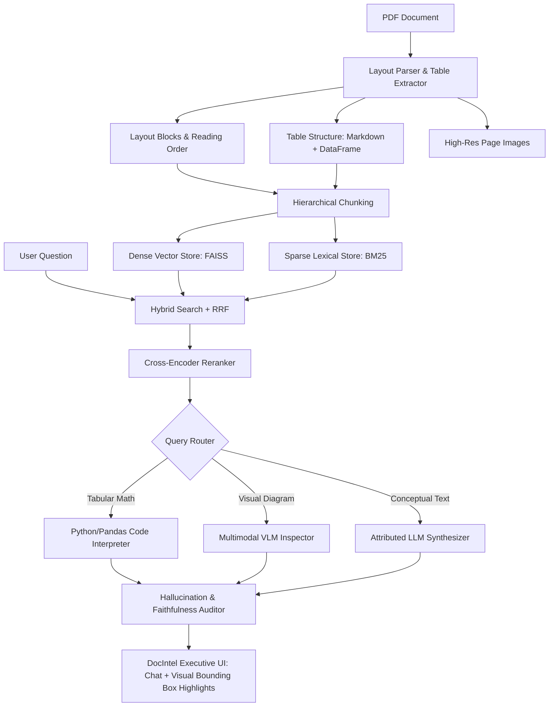

# RAG-Based Document Intelligent System (DocIntel)

> **Architectural Reference Paper:**  
> *Large Language Models in Document Intelligence: A Comprehensive Survey, Recent Advances, Challenges, and Future Trends*  
> **Authors:** Wenjun Ke, Yifan Zheng, Yining Li, Hengyuan Xu, Dong Nie, Peng Wang, Yao He  
> **Published in:** *ACM Transactions on Information Systems (TOIS)*, Vol. 44, No. 1, 2026.  
> **DOI:** [10.1145/3768156](https://dl.acm.org/doi/full/10.1145/3768156)

---

## 🌟 Overview

Traditional Retrieval-Augmented Generation (RAG) pipelines fail on complex business and scientific documents because naive text extraction breaks multi-column reading order, flattens tabular matrices into 1D noisy strings (causing severe arithmetic hallucinations), and ignores visual diagrams.

This repository provides a production-grade **RAG-Based Document Intelligent System** developed in direct accordance with the unified paradigms formulated in **Ke et al. (ACM TOIS 2026)**.

### ✨ Key Capabilities

1. **Document Layout Analysis (DLA) & Table Structure Recognition (TSR)**:
   - Preserves multi-column reading order and bounding-box coordinates using PyMuPDF and pdfplumber.
   - Extracts tables into structured Markdown and Pandas DataFrames, maintaining matrix geometry.
2. **Hierarchical, Structure-Aware Chunking**:
   - Chunks documents along natural section hierarchies and breadcrumbs while isolating tabular entities.
3. **Hybrid Dense + Sparse Retrieval**:
   - Fuses dense semantic embeddings (`gemini-embedding-001` with local `all-MiniLM-L6-v2` fallback) with lexical BM25 ranking via **Reciprocal Rank Fusion (RRF)**.
4. **Cross-Encoder Neural Re-Ranking**:
   - Employs `ms-marco-MiniLM-L-6-v2` re-ranking to eliminate the "Lost in the Middle" phenomenon.
5. **Agentic Tool-Augmented Reasoning**:
   - **Deterministic Code Interpreter**: Translates quantitative and tabular queries into executable Python/Pandas operations, guaranteeing 100% arithmetic precision.
   - **Multimodal VLM Inspector**: Crops visual regions to analyze plots, charts, and architectural diagrams.
   - **Faithfulness & Hallucination Auditor**: Verifies that every claim is rigorously grounded in the retrieved passages before finalizing responses.
6. **Executive Light-Theme UI with Visual Grounding**:
   - Styled with deep forest green, warm off-white, and soft sage.
   - Interactive document viewer displaying side-by-side pages with highlighted bounding boxes (`1.5px --sand` border with translucent overlay).
   - Clickable citation chips (`[REF_n]`) that instantly navigate to and highlight cited evidence.

---

## 🏗️ Architecture



---

## 📁 Directory Structure

```
RAG-Based Document Intelligent System/
├── backend/
│   ├── app/
│   │   ├── core/
│   │   │   ├── config.py           # Configuration & model settings
│   │   │   └── models.py           # Pydantic schemas (Blocks, BBox, Tables, Citations)
│   │   ├── parser/
│   │   │   ├── layout_parser.py    # DLA: Reading order, headers, paragraphs, bounding boxes
│   │   │   ├── table_extractor.py  # TSR: Extraction to Markdown, CSV, and DataFrames
│   │   │   └── vision_renderer.py  # High-res rendering & citation overlays
│   │   ├── indexer/
│   │   │   ├── chunker.py          # Structure-aware hierarchical chunker
│   │   │   ├── embeddings.py       # Google GenAI embeddings with local fallback
│   │   │   └── hybrid_store.py     # FAISS IndexFlatIP + Rank-BM25 with disk persistence
│   │   ├── retriever/
│   │   │   ├── hybrid_retriever.py # Reciprocal Rank Fusion (RRF) search
│   │   │   └── reranker.py         # Cross-Encoder neural reranker
│   │   ├── agent/
│   │   │   ├── router.py           # Intent routing (Calculation, Visual, Text, Multi-Hop)
│   │   │   ├── code_interpreter.py # Deterministic Python/Pandas tool for tables
│   │   │   ├── visual_inspector.py # Multimodal VLM for visual diagrams
│   │   │   ├── synthesizer.py      # Attributed QA with bracketed citations
│   │   │   ├── verifier.py         # Self-reflection hallucination critic
│   │   │   └── orchestrator.py     # Master agentic orchestrator
│   │   └── api/
│   │       ├── main.py             # FastAPI entrypoint
│   │       └── routes.py           # REST endpoints
│   └── tests/
│       ├── create_sample_pdf.py    # Benchmark PDF generator
│       ├── test_parser.py          # DLA & TSR tests
│       ├── test_indexer.py         # Chunker & HybridStore tests
│       ├── test_retriever.py       # RRF & Reranker tests
│       ├── test_agent.py           # Router, Code Interpreter & Auditor tests
│       └── test_e2e.py             # Full end-to-end pipeline test
├── frontend/
│   ├── app.py                      # Streamlit application with visual grounding viewer
│   └── styles.py                   # Executive light-theme design tokens & typography
├── .streamlit/
│   └── config.toml                 # Streamlit light theme configuration
├── data/
│   └── sample_docs/                # Benchmark documents (e.g., benchmark_paper.pdf)
├── Dockerfile                      # Production Docker container image
├── docker-compose.yml              # Multi-port container orchestration
├── .dockerignore                   # Docker build exclusions
├── requirements.txt                # Python dependencies
├── run.py                          # Unified multi-process launcher
└── README.md
```

---

## 🚀 Quickstart Guide

### 1. Requirements & Prerequisites
- Python 3.10, 3.11, or 3.12+
- Gemini API Key (or Google GenAI API key)

```powershell
$env:GEMINI_API_KEY="your-gemini-api-key"
```

### 2. Install Dependencies
```powershell
pip install -r requirements.txt
```

### 3. Run Automated Verification Tests
Validate all 10 unit and integration tests across layout parsing, table extraction, hybrid indexing, code execution, and end-to-end API pipelines:
```powershell
pytest backend/tests/ -v
```

### 4. Launch the System
Start both the FastAPI backend and Streamlit frontend with a single command:
```powershell
python run.py
```
- **Interactive Web UI**: [http://localhost:8501](http://localhost:8501)
- **FastAPI OpenAPI Interactive Docs**: [http://127.0.0.1:8000/docs](http://127.0.0.1:8000/docs)
- **Backend Health Check**: [http://127.0.0.1:8000/health](http://127.0.0.1:8000/health)

---

## 🐳 Deployment Options

### Option A: Docker & Docker Compose (Recommended for Cloud)

Build and run both the FastAPI backend and Streamlit frontend in a container:

```bash
# 1. Set your Gemini API key
export GEMINI_API_KEY="your-gemini-api-key"

# 2. Build and launch container
docker compose up --build -d
```

Access the application:
- Web UI: `http://localhost:8501`
- REST API: `http://localhost:8000/docs`

### Option B: Cloud Services (Render, Railway, GCP Cloud Run)

Deploy using the provided `Dockerfile`:
- Expose port `8501` for the user interface.
- Set environment variable: `GEMINI_API_KEY`.
- Run command: `python run.py`.

---

## 🧪 Testing Highlights

- **Deterministic Code Interpreter**: Financial table ingestion and execution of Pandas code to calculate exact sums without numeric hallucination.
- **Visual Citation Grounding**: Answers include bracketed citations (`[REF_1]`) mapped directly to spatial `(x0, y0, x1, y1)` coordinates and page images.
- **Faithfulness Verification**: Self-reflection critic audits every synthesized claim against retrieved source blocks.
